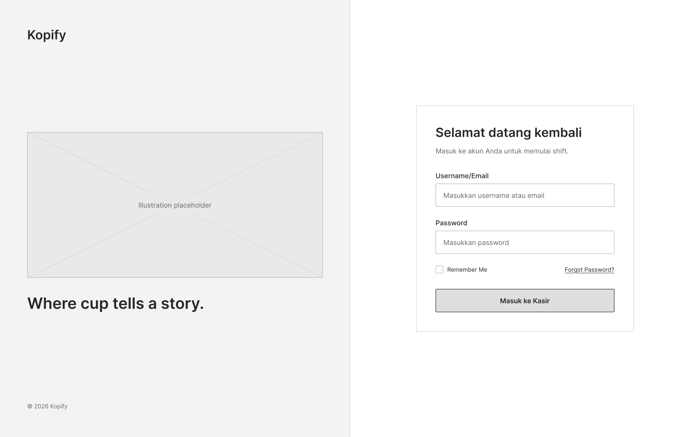

# Kopify - Aplikasi Kasir dan Manajemen Stok Kedai Kopi

**Anggota Tim:**

1. Api Widi Pratama - A11.2025.16268
2. Afrizal Irfan - A11.2025.16532
3. Dimas Putra Wijaya - A11.2025.16431

---

## Repository Git

Repository GitHub Kopify dapat diakses melalui tautan berikut:

**Tautan repository:** [Dev-Crafters-io/Kopify](https://github.com/Dev-Crafters-io/Kopify)

---

## 1. Latar Belakang & Studi Kasus

Kopify adalah sistem Point of Sale (POS) dan manajemen inventaris berbasis web untuk mendigitalisasi operasional kedai kopi. Sistem ini menyelesaikan masalah pencatatan manual yang sering memperlambat alur kerja kedai skala kecil–menengah, di antaranya:

- **Stok Fisik Tidak Terpantau:** Memisahkan pencatatan bahan satuan (seperti _takeaway cup_ atau _pastry_) dari menu jadi, memastikan jumlah fisik tercatat akurat dan terstruktur di dalam katalog.
- **Blind-Spot Pengawasan:** Menyediakan _dashboard_ agar pemilik dapat memantau penjualan dan sisa stok kapan saja, tanpa harus menunggu rekap pergantian _shift_.
- **Keterlambatan Pembaruan Stok:** Memotong stok secara otomatis saat transaksi kasir disimpan. Hal ini mencegah kasir kehabisan barang esensial di tengah jam sibuk karena lupa update buku stok.
- **Rekapitulasi Manual:** Menggantikan proses perhitungan nota kertas dengan kalkulator saat _closing_ menggunakan pencatatan riwayat transaksi digital.

---

## 2. Target Pengguna

Sistem memisahkan akses pengguna ke dalam 2 _role_ operasional:

1. **Admin / Kasir:** Eksekutor harian. Memiliki akses penuh (CRUD) terhadap manajemen produk, kategori, pembaruan stok, dan pemrosesan transaksi di meja kasir.
2. **Pemilik:** Pengawas operasional. Akses bersifat _read-only_ (opsional) untuk melihat _dashboard_ harian dan ringkasan stok tanpa izin untuk mengubah atau menghapus riwayat data.

---

## 3. Rencana Fitur Utama

Fitur berikut merupakan target pengembangan Kopify pada milestone berikutnya. Pada Milestone 1, fokus proyek masih berada pada perencanaan, kebutuhan pengguna, dan rancangan antarmuka.

- **Autentikasi:** Login, Logout, dan Proteksi terhadap halaman-halaman sensitif.
- **Manajemen Inventaris (CRUD):** Kelola kategori, registrasi data produk, dan pengaturan jumlah stok.
- **Sistem Transaksi:** Antarmuka kasir untuk memproses pesanan dan menghitung total secara otomatis yang terhubung dengan pengurangan stok.
- **Navigasi AJAX:** Tampilan tabel daftar produk dan riwayat transaksi menggunakan fitur _pagination_ berbasis jQuery AJAX (navigasi perpindahan data tanpa _reload_ halaman).
- **Indikator Real-time:** Tampilan tanggal dan jam interaktif menggunakan JavaScript pada antarmuka pengguna.

---

## 4. Rancangan Antarmuka

Tata letak dan _mockup_ antarmuka dirancang di **Figma**.

**Tautan Figma:** [Kopify POS - all design](https://www.figma.com/design/BMnRDSZJZvuPr5d14G8Ccm/Kopify-POS-all-design?t=Yc5aYdiZTt4xx6Oe-1)

### Halaman Inti Milestone 1

Wireframe yang disiapkan mencakup halaman inti berikut:

1. **Halaman Login** - autentikasi Admin/Kasir dan Pemilik.
2. **Dashboard** - ringkasan operasional dan akses cepat ke menu kasir.
3. **Daftar Data** - daftar produk dan informasi stok dalam katalog/inventaris.
4. **Form** - form tambah atau edit data produk.

### Preview Wireframe

**Login**

**Dashboard, Daftar Data, dan Form**

---

## 5. Fitur Pengembangan Opsional

Sistem juga mengimplementasikan modul tambahan untuk efisiensi di lapangan:

1. **Cetak Struk Transaksi:** Fitur cetak bukti pembayaran fisik (_thermal receipt layout_) berbasis HTML standar.
2. **Peringatan Batas Stok:** Indikator peringatan visual (_alert_) pada _dashboard_ yang menyala otomatis jika sisa barang fisik menyentuh batas minimum.

---

## 6. Log Penggunaan AI

Sesuai ketentuan PjBL, aktivitas penggunaan AI sebagai _copilot_ dicatat secara berkala selama pengerjaan Milestone 1.

<b>Lihat Riwayat Lengkap Log Penggunaan AI (13–18 Oktober 2026)</b>

 

| Tanggal     | Tujuan                                   | Prompt / Perintah                                                                                                                                      | Bagian Solusi yang Dibantu                                                            | Penjelasan Konsep & Penyesuaian Mandiri                                                                     | Hasil Pengujian                                                      |
| :---------- | :--------------------------------------- | :----------------------------------------------------------------------------------------------------------------------------------------------------- | :------------------------------------------------------------------------------------ | :---------------------------------------------------------------------------------------------------------- | :------------------------------------------------------------------- |
| 13 Okt 2026 | **Struktur direktori & kerangka README** | "Bagaimana struktur folder repositori Git yang rapi untuk proyek web tugas PjBL, serta kerangka awal untuk README.md?"                      | Rekomendasi direktori modular (`js/`, `css/`, `assets/`, `src/`) dan format README    | Mengatur pemisahan folder aset gambar dan proposal; menyusun draf latar belakang studi kasus Kopify         | Direktori Git lokal terinisialisasi bersih dan siap kolaborasi       |
| 13 Okt 2026 | **Antarmuka login split-screen**         | "Bagaimana cara mendesain halaman login split-screen yang modern untuk aplikasi kasir kafe dengan pemisahan peran kasir dan pemilik?"                  | Panduan layout split-screen dan UX dual button login kasir vs owner                   | Menyesuaikan tema warna espresso-krem, menambahkan maskot kopi, dan memisahkan tombol login kasir dan owner | Halaman login rapi dan memudahkan pemilihan role operasional         |
| 14 Okt 2026 | **Strategi Git 3 orang tanpa konflik**   | "Bagaimana strategi push dan alur kerja Git/GitHub yang aman untuk kolaborasi 3 orang di branch main agar tidak terjadi tabrakan atau merge conflict?" | Panduan kebiasaan `git pull`, config `pull.rebase false`, dan pembagian file          | Menyepakati pembagian kepemilikan file antar anggota dan wajib pull sebelum commit/push                     | Push perdana 3 anggota tim berjalan mulus tanpa file tertimpa        |
| 14 Okt 2026 | **Struktur layout Dashboard POS**        | "Bagaimana cara membuat layout dashboard POS di Figma langkah demi langkah berdasarkan desain referensi?"                                              | Breakdown layout: top bar, filter kategori, grid menu, tracker bawah, dan panel kasir | Menerapkan alur kasir cepat dengan tema espresso-krem dan indikator peringatan batas stok menipis           | Layout dashboard kasir selesai dengan proporsi seimbang              |
| 15 Okt 2026 | **Design audit & perbaikan UI**          | "Roast secara objektif seluruh desain antarmuka Kopify POS saya di Figma, temukan kekurangan visual, dan pandu perbaikannya."                          | Analisis kelemahan hierarki teks, konsistensi margin, dan kontras warna               | Menyeragamkan seluruh teks isi ke IBM Plex Sans dan memperbaiki kontras badge status ketersediaan           | Tampilan 6 layar lebih konsisten dan siap diturunkan ke wireframe    |
| 15 Okt 2026 | **Auto Layout komponen Figma**           | "Analisis desain dashboard Kopify saya dan pandu langkah-langkah menerapkan Auto Layout pada komponennya."                                             | Panduan direction, padding, gap, serta logika Hug vs Fill container                   | Menyesuaikan padding/gap kartu produk dan order item agar fleksibel menampung variasi teks harga            | Komponen kartu katalog fleksibel tanpa merusak layout                |
| 16 Okt 2026 | **Penerapan soft shadow elegan**         | "Bagaimana cara menerapkan soft shadow di Figma agar kartu dan panel tidak terlihat kaku?"                                                             | Formula Drop Shadow halus (blur besar, Y-offset kecil, opacity rendah tint tema)      | Menggunakan drop shadow 5–8% dengan basis warna dark espresso pada kartu dan panel pesanan                  | Komponen memiliki kedalaman visual natural menyatu dengan latar krem |
| 17 Okt 2026 | **Tabel inventaris & drawer edit**       | "Bagaimana cara merancang antarmuka tabel inventaris produk beserta drawer edit data yang rapi di Figma?"                                              | Layout metrik ringkasan di atas tabel dan pola slide-over drawer form edit            | Mengatur metrik stok kritis dan menyusun field input drawer (upload gambar, nama, kategori, harga, stok)    | Modul inventaris selesai dan siap dijadikan acuan halaman CRUD       |
| 17 Okt 2026 | **Tata letak struk kasir termal**        | "Bagaimana cara merancang layout struk kasir termal di Figma yang padat dan informatif berdasarkan referensi?"                                         | Hierarki struk: header, metadata, rincian pesanan, total, dan info pelengkap          | Mengunci lebar 340px, tipografi khas, badge QRIS, promo voucher, dan info WiFi kafe                         | Desain struk kasir termal padat, proporsional, dan siap cetak        |
| 18 Okt 2026 | **Konversi UI ke wireframe monokrom**    | "Bagaimana cara mengubah desain UI berwarna di Figma menjadi wireframe abu-abu/grayscale secara cepat?"                                                | Teknik duplikasi frame dan layer overlay blend mode saturation/color                  | Menerapkan overlay saturation pada 6 frame duplikat dan memeriksa kontras teks monokrom                     | Seluruh 6 layar monokrom selesai diekspor sebagai aset wireframe     |

